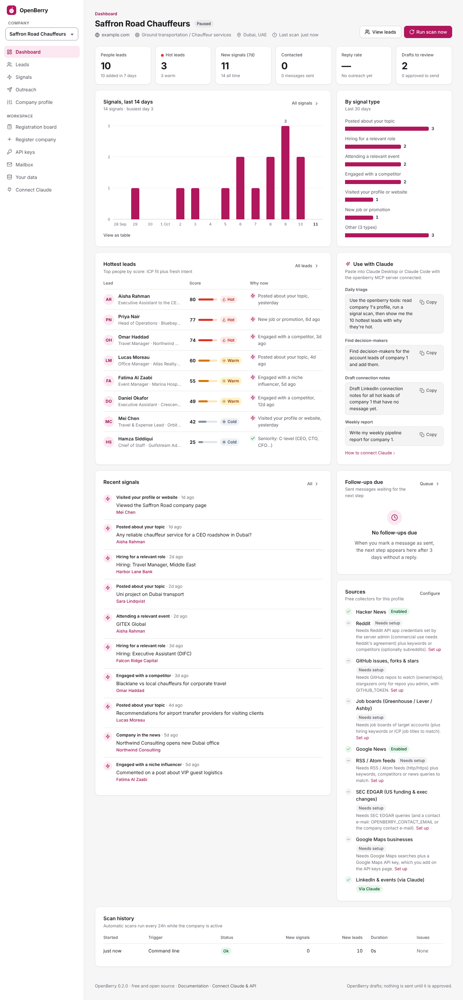
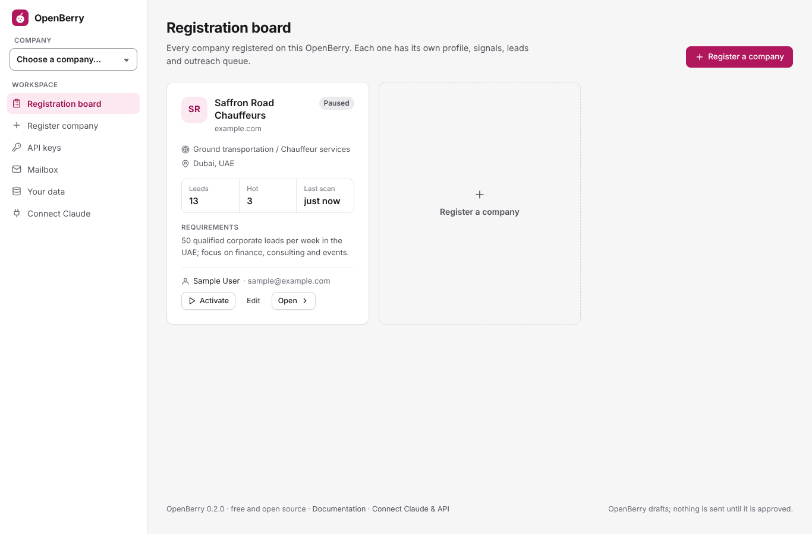
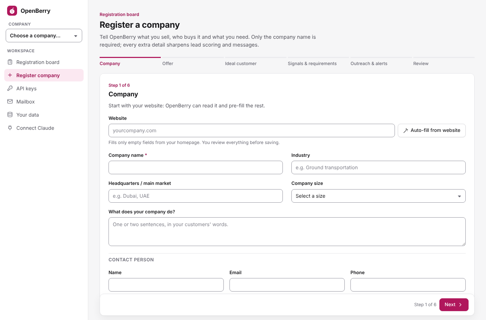
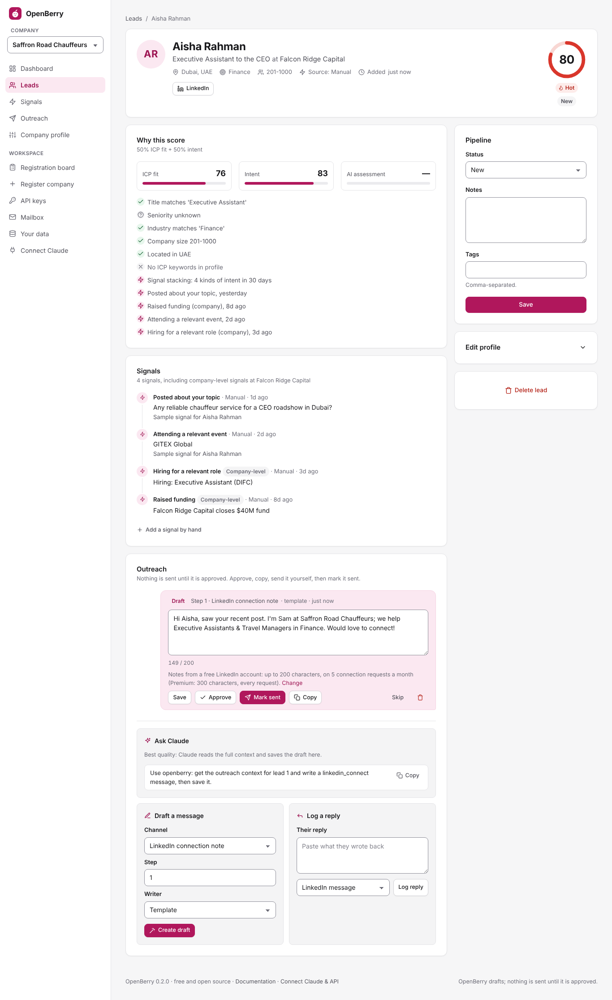
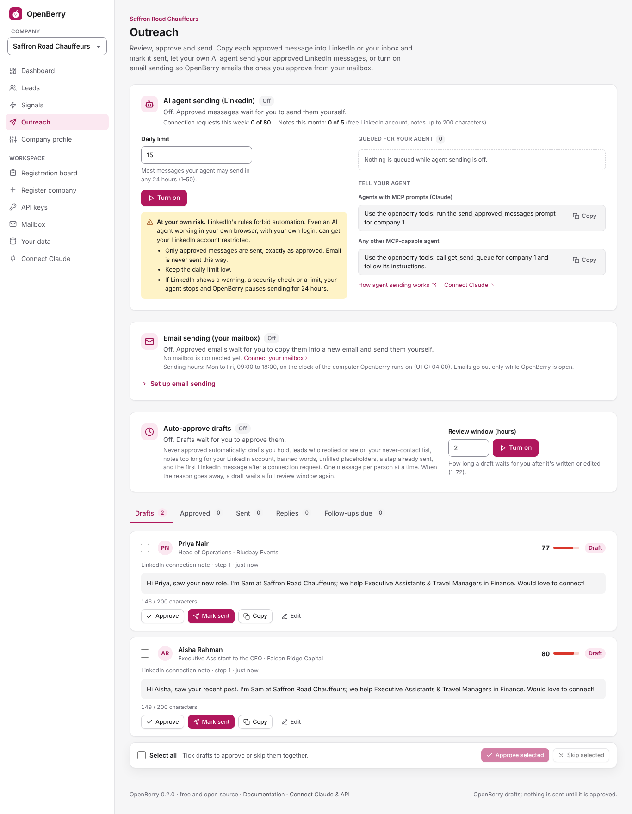
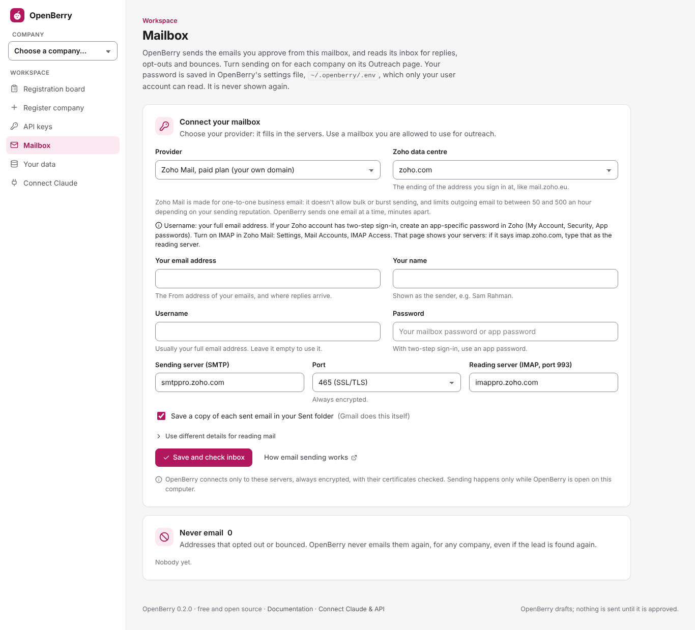

# 🍓 OpenBerry

**A free, self-hosted, open-source alternative to [Gojiberry](https://gojiberry.ai).** It finds warm B2B leads from
public intent signals, scores them against your ideal customer, and drafts personal outreach. Claude does the
thinking through MCP, and a web dashboard (with a registration board for your company details and requirements) keeps everything in one place.



## Download the app

| Windows 10/11 | Mac (Apple silicon) | Linux |
|---|---|---|
| [**OpenBerry for Windows**](https://github.com/connexionlimodubai-pixel/gj/releases/latest/download/OpenBerry-windows-x64.zip) (39 MB) | [**OpenBerry for Mac**](https://github.com/connexionlimodubai-pixel/gj/releases/latest/download/OpenBerry-macos-arm64.zip) (39 MB) | [**OpenBerry for Linux**](https://github.com/connexionlimodubai-pixel/gj/releases/latest/download/OpenBerry-linux-x64.tar.gz) (43 MB) |
| Unzip (right-click → **Extract All**), then double-click **OpenBerry.exe**. If Windows says it protected your PC, click **More info → Run anyway**. | Unzip, drag **OpenBerry.app** to Applications and open it. The first time, macOS blocks it: on macOS 15 or later, click **Open Anyway** in **System Settings → Privacy & Security** ([steps](docs/DESKTOP.md#mac)). | Extract and run `./OpenBerry`: it opens in your browser. |

These links always download the newest version. Release notes and older versions are on the [Releases page](https://github.com/connexionlimodubai-pixel/gj/releases).
The app isn't code-signed, which is why Windows and macOS ask you to confirm once. Step-by-step help: [docs/DESKTOP.md](docs/DESKTOP.md).

## What it does

1. **Register your company** on the registration board: what you sell, who buys it (your ICP), which signals to watch,
   your requirements and your outreach style. It can auto-fill from your website.
2. **Collect intent signals** on a schedule from free public sources:
   - Hacker News, GitHub, Greenhouse/Lever/Ashby job boards, Google News, RSS and SEC EDGAR
   - Reddit, if you have API access
   - Google Maps businesses (hotels, event planners, law firms...) with the email and phone from their own websites,
     once you paste a Google Maps API key on the **API keys** page
   - LinkedIn and anything else Claude can browse
3. **Score every lead** transparently: ICP fit + time-decayed intent + signal stacking, plus Claude's own judgement.
   Every point is explained ("Title matches 'Travel Manager'", "Hiring for a relevant role, 3d ago").
4. **Draft outreach** with Claude (or a free local Ollama model, or templates): LinkedIn notes, DMs, emails and follow-ups.
   **Nothing is sent before it is approved**: by you, or by auto-approve if you turn it on. You review, copy, send and
   mark as sent. If you choose, your own AI agent sends the approved LinkedIn messages
   ([AI agent sending](#ai-agent-sending-optional-at-your-own-risk)), and OpenBerry emails the approved emails from
   your own mailbox ([email sending](#email-sending-optional)). Both are off by default.
   Approve drafts one at a time, or tick several on the Outreach page and approve them together. The page keeps your
   place when it reloads. If you can't keep up, turn on **auto-approve** (off by default): drafts you don't approve,
   hold or skip are approved after a review window you choose (2 hours by default, counted from the last edit), and
   never for leads who replied or are on your never-contact list.
5. **Read your mailbox** (if you connect it on the **Mailbox** page): a reply stops the sequence, an opt-out puts the
   address on a never-email list, and a bounce marks the address as not working. A reply that only looks like an
   opt-out is flagged **Looks like an opt-out**, and you decide.
6. **Alert you** on Slack or Discord when a person lead turns hot, whether a scan, Claude, the API, a CSV import or an edit
   made it hot. Alerts go out after each scan and, while `openberry serve` runs, within a few minutes.
   Export every lead to CSV or use the JSON API with n8n or Activepieces.
7. **Keep your data safe**: everything stays on your computer, in one file. OpenBerry saves a copy every day and
   before every upgrade, and **Your data** downloads a backup in one click ([Back up your data](#back-up-your-data)).

| Registration board | Register a company | Lead detail |
|---|---|---|
|  |  |  |

| Outreach: review, approve, send | Mailbox: email from your own address |
|---|---|
|  |  |

See [docs/GOJIBERRY_COMPARISON.md](docs/GOJIBERRY_COMPARISON.md) for a feature-by-feature comparison.

## Desktop app (no terminal needed)

Download OpenBerry for **Windows**, **Mac** (Apple silicon) or **Linux** [above](#download-the-app) or from the
[Releases page](https://github.com/connexionlimodubai-pixel/gj/releases/latest), unzip it and double-click **OpenBerry**.
The dashboard opens in its own window, and your data stays on your computer. Claude Desktop connects to it
through the **Connect Claude** page in the app. You don't need Python or a terminal.

The app isn't code-signed yet, so Windows and macOS ask you to confirm the first time you open it.
[docs/DESKTOP.md](docs/DESKTOP.md) explains each step, how to update, and how to build and release the app.

## Quick start (5 minutes)

You need [uv](https://docs.astral.sh/uv/getting-started/installation/), a fast Python installer. Python 3.11+ is fetched automatically.

```bash
git clone https://github.com/connexionlimodubai-pixel/gj.git openberry && cd openberry
uv run openberry serve    # → open http://127.0.0.1:8000
```

Register your company (or ask Claude to interview you: see below), then click **Run scan now** on your dashboard.
Data lives in `~/.openberry/openberry.db` (move it with `OPENBERRY_HOME` or `OPENBERRY_DB`).

### With Docker
```bash
cp .env.example .env      # set OPENBERRY_PASSWORD (12+ characters), OPENBERRY_SECRET_KEY and OPENBERRY_API_TOKEN
docker compose up -d      # → http://127.0.0.1:8000
```
Inside the container OpenBerry listens on all addresses, so it refuses to start without a password. If only you can
reach it (compose publishes it on 127.0.0.1), you can set `OPENBERRY_ALLOW_NO_PASSWORD=true` instead.
Docker reads `$name` in `.env` as a variable: put a password with a `$` in it in single quotes,
`OPENBERRY_PASSWORD='...'`. To update to a new version: `git pull && docker compose up -d --build` (your data stays in
the `openberry-data` volume).
For a server that other people reach, see [Run it on a server](#run-it-on-a-server).

## Connect Claude (the AI SDR)

Add OpenBerry to **Claude Desktop** (*Settings → Developer → Edit Config*):
```json
{
  "mcpServers": {
    "openberry": {
      "command": "uv",
      "args": ["--directory", "/ABSOLUTE/PATH/TO/openberry", "run", "openberry", "mcp"]
    }
  }
}
```
Claude Desktop doesn't always see your shell's `PATH`: if it can't start `uv`, put uv's full path (`which uv`) in `"command"`.
The dashboard's **Connect Claude** page (`/help`) shows the exact command and config for your install, Docker and the
desktop app included (the app's config runs its bundled `openberry-cli mcp`).

For **Claude Code**: run `claude` inside this folder (the included `.mcp.json` registers the server), or run
`claude mcp add openberry -- uv --directory /ABSOLUTE/PATH/TO/openberry run openberry mcp`.

Then ask Claude things like:
- *"Set up OpenBerry for my company: read example.com, interview me, and register us."*
- *"Run today's lead hunt for my company and show me the 10 hottest leads with why."*
- *"Find the decision-makers at the companies that are hiring, and add them."*
- *"Draft LinkedIn connection notes for every hot lead that has no message yet."*

Claude gets 25 tools (scan, prospecting plan, add leads, assess, outreach context, save draft, log reply, pipeline report,
the send queue for your own browser agent, the email sending status…), plus prompts such as `daily_lead_hunt`. See [docs/CLAUDE_MCP.md](docs/CLAUDE_MCP.md).
To let Claude browse LinkedIn and the web too, add free open-source MCP servers next to OpenBerry
(Playwright, fetch, SearXNG, and optionally a LinkedIn MCP server at your own risk). See [docs/OPEN_SOURCE_STACK.md](docs/OPEN_SOURCE_STACK.md).

## AI agent sending (optional, at your own risk)

OpenBerry never opens LinkedIn or sends LinkedIn messages itself. If you turn on **AI agent sending** for a company (Outreach page,
off by default), an AI agent running in your own browser, logged in to your LinkedIn, can send the approved LinkedIn
messages. Claude in Chrome and Playwright MCP's extension mode both work. OpenBerry enforces the rules itself:
- approved messages only, exactly as approved, and LinkedIn only (never email)
- a daily limit (default 15 in any 24 hours), and LinkedIn's connection limits: notes of at most 200 characters on a
  free LinkedIn account (300 on Premium), a note on at most 5 connection requests a month on a free account, and at
  most 80 connection requests in any 7 days
- never leads who replied or are on your never-contact list
- a 24-hour pause, with a Resume button, as soon as the agent reports a LinkedIn warning, check or limit

If you also turn on **auto-approve**, your agent may send drafts you didn't read in time: they are approved once their
review window has passed. Hold the ones you want to check first. Auto-approve never approves the first LinkedIn message
after a connection request (did they accept?), a step already sent, or a draft with a banned word or an unfilled
placeholder. Claude and the JSON API can turn agent sending and auto-approve off, never on.

There are no tricks to hide automation. LinkedIn's User Agreement forbids automated messaging, so your account can be
restricted. Read [docs/AI_AGENT_SENDING.md](docs/AI_AGENT_SENDING.md) before you turn it on.

## Email sending (optional)

Connect your own mailbox on the **Mailbox** page (Zoho Mail, Hostinger, Gmail with an app password, or any provider with
SMTP and IMAP), then turn on **Email sending** for a company on its Outreach page (off by default). While the dashboard
or the desktop app is open, OpenBerry emails the emails you approved, one at a time, from your mailbox:
- approved emails only, exactly as approved, plain text, with your footer (who you are, your address, how to opt out)
- a daily limit (default 30, at most 100), at least 5 minutes between two emails, and sending hours (default Monday to
  Friday, 09:00 to 18:00)
- one email per person (and per address, whichever leads share it) at a time, follow-ups only when due and after the
  earlier step, never twice, never leads who replied or are on your never-contact list
- it reads your inbox (read-only) every 5 minutes: a reply stops the sequence, an opt-out ("unsubscribe", "STOP",
  also in Arabic) puts the address on a never-email list, a bounce marks the address as not working

Your password stays in the data folder's `.env` file, never in the database, never shown to Claude or the API. Claude
and the API can turn email sending off, never on. **Hostinger forbids email to people who did not opt in**, and Zoho
Mail allows one-to-one business email only: use a separate mailbox (ideally a separate domain) for outreach, set up
SPF, DKIM and DMARC, and start with 5 to 10 a day. Read [docs/EMAIL_SENDING.md](docs/EMAIL_SENDING.md) first.

## Back up your data

Everything is in one SQLite file, `~/.openberry/openberry.db` (Docker: the `openberry-data` volume). OpenBerry saves a
copy in the `backups` folder next to it every day (7 days and 4 weeks are kept), before a schema upgrade, before
Delete company and before a restore. For a copy of your own, open **Your data** in the dashboard and click
**Download backup**, or run `openberry backup`: both are safe while OpenBerry runs. Don't copy `openberry.db` alone
while OpenBerry or Claude uses it: its newest changes are in `openberry.db-wal`. To put a backup back, close OpenBerry
(and Claude Desktop) and run `openberry restore FILE`. [docs/DESKTOP.md](docs/DESKTOP.md#back-up-your-data) has the
details, and how to update and uninstall.

## Run it on a server

On your own computer OpenBerry needs no login. On a server that other people can reach, it needs a password and
HTTPS, so the password and the login cookie never cross the internet in plain text. `docker-compose.yml` has a
**Caddy** service for that (the `caddy` profile): it gets a free certificate from Let's Encrypt and renews it by itself.

1. Point a domain at the server (for example `leads.example.com`), and open ports 80 and 443 in its firewall.
2. Make a secret key and an API token. Run this twice and copy each line it prints:
   ```bash
   python3 -c "import secrets; print(secrets.token_urlsafe(32))"
   ```
   Choose a password of 12 characters or more (or run the command a third time and keep it in a password manager).
3. `cp .env.example .env`, then set these in `.env`:
   ```
   OPENBERRY_BASE_URL=https://leads.example.com
   OPENBERRY_PASSWORD='your-password'
   OPENBERRY_SECRET_KEY=the-first-line
   OPENBERRY_API_TOKEN=the-second-line
   OPENBERRY_TRUSTED_PROXIES=172.16.0.0/12,192.168.0.0/16
   TZ=Asia/Dubai
   ```
   Keep the single quotes around the password: without them Docker reads `$name` in it as a variable, and the
   password you type would not work.
4. Start it: `docker compose --profile caddy up -d`. Open `https://leads.example.com` and log in.

What you get:
- Caddy answers on ports 80 and 443 and sends every `http://` visit to `https://`. Because the address starts with
  `https://`, the login cookie is only sent over HTTPS, and browsers are told to use HTTPS only (HSTS).
- OpenBerry itself stays on Docker's internal network. Its own port is published on the server's 127.0.0.1 only, so
  from outside only Caddy reaches it.
- `OPENBERRY_TRUSTED_PROXIES` is Docker's private networks: OpenBerry believes the visitor's address that Caddy passes
  on. Each visitor then has their own login limit, and someone else's wrong passwords can't lock you out.
- Claude connects to `https://leads.example.com/mcp` with the API token (`Authorization: Bearer ...`), and the JSON API
  is at `https://leads.example.com/api`.
- OpenBerry refuses to start on a server address without a password of 12 characters or more. It warns when the secret
  key or the API token is missing or shorter than 32 characters, or when the address doesn't start with `https://`.

Another proxy (nginx, Traefik) works too: forward to OpenBerry's port, keep the `Host` header, pass `X-Forwarded-For`
and `X-Forwarded-Proto`, and put the proxy's address in `OPENBERRY_TRUSTED_PROXIES`.

## Configuration

Everything is optional for local use. Put settings in `.env` (read from the current folder and `~/.openberry/.env`)
or in the environment. See [`.env.example`](.env.example) for the other settings.

| Variable | Purpose |
|---|---|
| `OPENBERRY_PASSWORD`, `OPENBERRY_SECRET_KEY` | Dashboard login. **Required** if anyone but you can reach the server: `openberry serve` on an address other than 127.0.0.1 refuses to start without a password of 12 characters or more |
| `OPENBERRY_ALLOW_NO_PASSWORD=true` | Start on such an address without a password anyway: when something in front of OpenBerry asks for a login, or Docker publishes it on 127.0.0.1 only |
| `OPENBERRY_API_TOKEN` | Bearer token for `/api` and the HTTP MCP endpoint `/mcp`. Needed to use `/mcp` from another computer: `openberry mcp --http` on an address other than 127.0.0.1 refuses to start without one |
| `OPENBERRY_TRUSTED_PROXIES` | Behind a reverse proxy: its address or network (comma separated, `*` for any), so `X-Forwarded-For` gives each visitor's own address |
| `OPENBERRY_BASE_URL` | Public URL of the dashboard: links in Claude replies, an allowed host name, and Secure login cookies when it starts with `https://` |
| `OPENBERRY_ALLOWED_HOSTS` | Extra host names to answer to in local mode (no password). This only blocks DNS-rebinding attacks from websites, not another computer: to use `/mcp` from one, set `OPENBERRY_API_TOKEN` |
| `OPENBERRY_PUBLIC_REGISTRATION=true` | Let clients fill in the registration form themselves (agency intake). Their companies wait, paused, for your review |
| `OPENBERRY_CONTACT_EMAIL` | Contact e-mail for SEC EDGAR's required User-Agent |
| `OPENBERRY_GOOGLE_PLACES_KEY` | Google Maps API key for the Google Maps businesses source. Desktop users can paste it on the **API keys** page instead |
| `OPENBERRY_GOOGLE_PLACES_MONTHLY_LIMIT` | Most Google Maps searches a month (default 900; Google's free tier is 1,000) |
| `OPENBERRY_SMTP_HOST`, `_PORT` (465 or 587), `_USERNAME`, `_PASSWORD`, `_FROM_EMAIL`, `_FROM_NAME`; `OPENBERRY_IMAP_HOST`, `_USERNAME`, `_PASSWORD`, `_SAVE_SENT` | Your mailbox for [email sending](docs/EMAIL_SENDING.md). Usually saved from the dashboard's **Mailbox** page instead |
| `GITHUB_TOKEN` | Higher GitHub limits; stargazers of repos you admin |
| `REDDIT_CLIENT_ID`, `REDDIT_CLIENT_SECRET`, `REDDIT_USERNAME` | Optional Reddit source (see its terms) |
| `OPENBERRY_OLLAMA_URL`, `OPENBERRY_OLLAMA_MODEL` | Free local LLM: the "Local AI (Ollama)" writer in a lead's *Draft a message* card |
| `OPENBERRY_SCHEDULER=false` | Turn off automatic scans and the background hot-lead alerts |
| `OPENBERRY_HOME` | Data folder for `openberry.db` and the fallback `.env` (default `~/.openberry`). Environment only, not `.env` |
| `OPENBERRY_ENV_FILE` | Read settings only from this file instead of `./.env` and `~/.openberry/.env`. Environment only |

## Commands

```bash
openberry serve [--host 0.0.0.0 --port 8000]   # dashboard + /mcp + background scheduler
openberry desktop [--no-window]                # the dashboard in its own window (uv sync --extra desktop), else the browser
openberry mcp                                  # MCP over stdio (what Claude Desktop runs)
openberry mcp --http --port 8001               # standalone MCP over HTTP (needs OPENBERRY_API_TOKEN on a --host other than 127.0.0.1)
openberry scan [--company 1] [--source hackernews]
openberry rescore | init-db
openberry backup [PATH]                        # a consistent copy of the database, safe while OpenBerry runs
openberry restore FILE                         # put a backup back (OpenBerry closed); turns email and agent sending off
openberry remove-sample [--dry-run]            # the sample company an older version created: shows what goes, asks first
```
(Prefix with `uv run` if you haven't installed it with `pip install .`.)
If you change `--host` or `--port`, set `OPENBERRY_BASE_URL` to the URL you open in the browser: Claude's links use it,
and without a password the server only answers to that host, `localhost` and IP addresses.

## How it works

```
Claude Desktop / Code ──MCP──▶ OpenBerry ◀── dashboard (registration board, leads, outreach)
        │                          │
        └─ optional MCP servers    ├─ collectors: HN · GitHub · job boards · News/RSS · SEC · Reddit · Google Maps
           (Playwright, fetch,     ├─ scoring: ICP fit + intent decay + signal stacking + Claude score
            LinkedIn, SearXNG)     └─ SQLite (~/.openberry/openberry.db)
```
More detail: [docs/ARCHITECTURE.md](docs/ARCHITECTURE.md) and [docs/SIGNALS.md](docs/SIGNALS.md).

## Responsible use

- OpenBerry never automates LinkedIn itself. LinkedIn's User Agreement prohibits automation. If you add a
  LinkedIn MCP server or turn on [AI agent sending](docs/AI_AGENT_SENDING.md), that is your decision and your account's risk.
- Each data source has terms. They are summarised in [docs/SIGNALS.md](docs/SIGNALS.md). Google News RSS is for personal,
  non-commercial use, and Reddit requires an agreement for commercial use.
- Prospect data is personal data. Comply with GDPR, the UAE PDPL, CAN-SPAM and similar laws: contact people with relevant, honest messages and
  honour opt-outs.
- Google Maps: OpenBerry keeps only each business's Place ID, as Google's terms require. Contact details come from the
  business's own website. Read the [Google Maps Platform Terms](https://cloud.google.com/maps-platform/terms) before you use it.
- Email: these are business contact addresses. Email providers block mailboxes that send to people who didn't opt
  in (Hostinger's rules say so), and anti-spam laws apply. Send few, personal, relevant emails and honour opt-outs.
  OpenBerry sends email only if you turn on [email sending](docs/EMAIL_SENDING.md), only the emails you approved, and
  stops for anyone who replies, opts out or bounces.

## Development

```bash
uv sync --extra dev
uv run playwright install chromium        # once: the browser tests skip without it
uv run pytest            # no network needed
uvx ruff@0.16.8 check src tests packaging # the lint CI runs
```

The README's screenshots come from `scripts/screenshots.py`. It fills a new, empty data folder with fictional sample
data (paused, sending off), starts `openberry serve` on 127.0.0.1 and photographs the pages. It refuses a folder that
holds anything, and it can't reach the internet: no Google, no mail server. It is for developers only, and not part
of the app, the wheel or the Docker image.

```bash
OPENBERRY_HOME=/tmp/openberry-screenshots uv run --extra dev python scripts/screenshots.py  # docs/screenshots/*.png
```

Releases: [docs/DESKTOP.md](docs/DESKTOP.md#releasing-a-new-version) (what changed is in [CHANGELOG.md](CHANGELOG.md)).

MIT licensed. Not affiliated with Gojiberry.
